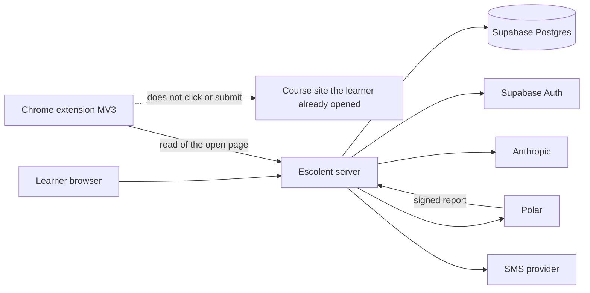

# Escolent — Structural Design

**Subtitle:** How the learner MVP is built — containers, modules, the mastery engine, the model boundary, the schema, and the year-one runtime  
**Status:** v1.4 — structural design of record. This file does not add product rules.  
**Last updated:** 9 October 2026 (Africa/Cape Town)  
**Owner:** Tychique Lesambo · **Ship authority:** Tychique Lesambo  
**Requirements of record:** `docs/PRODUCT-REQUIREMENTS.md` v1.3  
**Design-system source of truth:** `escolent-student-demo` route `/design-system`  
**Supersedes:** `escolent-student-demo/cursor-handoff/docs/design.md`. That file describes the retired school-pilot product (teacher shells, a Grade 8 course, LTI, distress detection). It is not the structure of this MVP.

## Changelog

| Version | Date | Author | Notes |
|---|---|---|---|
| **v1.4** | **9 October 2026** | Tychique Lesambo / engineering | Locks the two remaining build choices. The course-account id is the site host plus that vendor’s own user field, taken from the read. The shell cache is an IndexedDB snapshot that stores places, the read line, and labels, and does not store problems or answer keys. |
| **v1.3** | **9 October 2026** | Tychique Lesambo / engineering | Finishes the AI-engine closures so each has one reading. Ask class is code, in a fixed order, and specimen problem phrases are not the product list. A granted page that is already a reference item is open writing. The key match is defined token by token. A short page may use its whole text as the source span. A lesson and a practice problem reject each other in either order. A failed draft names the skill and does not use the ended-trial sentence. |
| **v1.2** | **9 October 2026** | Tychique Lesambo / engineering | Closes the AI-engine holes. A wrong Check shows the stored miss note with the easier problem and does not call the model. Open writing is classified by code before a problem is drafted, and a failed draft does not become abstain. Lessons, explanations, and problems are accepted or rejected by code, including a whole-token key check and a verbatim source span. A miss resets the review gap to 1 so the next durable success starts again at 3 days. |
| **v1.1** | **9 October 2026** | Tychique Lesambo / engineering | Closes the ten holes from the structural pressure test. Cancel keeps practice open until `period_end`. A paid trial cannot be swept to `free`. An edge is copied only from an order the learner’s source already states. A practice problem is taken from that source. Still-reading and offline are sequences that add nothing. The two tentative dates, the connection token, a live session, freshness, and USD amounts are specified. |
| **v1.0** | **9 October 2026** | Tychique Lesambo / engineering | First structural design for the locked learner MVP. Names the runtime, the module boundaries, the Bayesian Knowledge Tracing update, the model boundary, and the column-level schema. Does not carry the retired handoff. |

**What this document does:**

- Turns Requirements 1–41 into a buildable structure.
- Specifies the mastery engine, including the update equation and the test vectors.
- Specifies where Anthropic is allowed to run, and where it is not called.
- Specifies the tables, the access rules, and the year-one runtime.

**What this document does not do:**

- It does not reopen a locked product rule. If this file and the requirements disagree, the requirements win and this file is corrected.
- It does not authorise staff shells, a course catalog, Stripe, a hint button, open-writing scores, or a sold check on the graph.
- It does not replace the implementation-task document. That document is `docs/IMPLEMENTATION-TASKS.md`.

---

## How to read this document

1. **§1 System** — what runs, and what is outside Escolent.
2. **§2 Runtime** — year-one hosts and providers.
3. **§3 Modules** — E1–E11 as code boundaries.
4. **§4 Paths** — the sequences a builder implements, including still-reading and offline.
5. **§5 Mastery engine** — the only writer of a label.
6. **§6 Model boundary** — the only caller of Anthropic.
7. **§7 Schema** — columns, keys, and the tables that must not exist.
8. **§8 Access** — who can read a row.
9. **§9 Adapters** — auth, phone, read doors, Polar.

---

## 1. System

Escolent is a window on a course the learner already has. The browser shell, the Chrome extension, and the server are the product. The course site, the card network, and the model provider are outside it.



The learner shell is a Next.js app. It is not Chrome-only. The extension exists only for the page-already-open door.

A parent never receives a problem, an answer, or a score. A school-age session never receives a price, a payment failure, or “number already used.” Those omissions are response shapes, not CSS.

---

## 2. Runtime

Year-one stack: Node 20, TypeScript, Next.js App Router. The learner graph is Supabase Postgres. Identity for email and Google is Supabase Auth. The server is the only process that holds the service role.

| Piece | Year-one choice | Job |
|---|---|---|
| Web and API | Next.js on AWS App Runner | Shell, door, and the module APIs |
| Edge | CloudFront in front of App Runner | HTTPS and static caching of the shell |
| Database and auth | Supabase Postgres and Supabase Auth | Rows, email code, Google return |
| Files | Amazon S3, private | File-door objects and the text extracted from them |
| Trial clock | Amazon EventBridge | Sweeps ended trials even when the learner is away |
| Hot reads | Amazon ElastiCache | Entitlement snapshot and sign-out revocation. Not the graph |
| Email code | Supabase Auth | Six-digit code. The template contains the token and no link |
| Phone code | `SmsProvider`, Amazon SNS in year one | Six-digit code to the number the payer entered |
| Model | `LlmProvider`, Anthropic in year one | Drafts and explanations only |
| Card | `BillingProvider`, Polar in year one | Checkout and the paid or failed report |
| Open page | Chrome extension, Manifest V3 | Read of the tab the learner already opened |

Paddle is a second `BillingProvider` implementation that is not selected. `BILLING_PROVIDER=polar`. There is no Stripe adapter.

ECS is the spare compute if App Runner cannot host the server. It is not a second design. ElastiCache does not store skill rows, problems, or answer keys. A cache miss reads Postgres.

`HELPLINE_NUMBER` is an environment variable on the server. The client receives the number only from that variable. The specimen `+1 555 0199` is not in the production build. When the variable is unset, the helpline control says the line is not published yet.

### 2.1 Sessions

Supabase Auth proves email or Google. Escolent then opens its own server session.

0. A request whose cookie names a `session` row with `ended_at` null opens that person’s shell. The door is not replayed. No trial row is inserted. A school-age session still uses `SchoolPayload`.
1. Email continues only after `verifyOtp` accepts the six-digit token on the door. Google returns to the door route and does not ask for that token.
2. The server inserts a `session` row and sets an httpOnly cookie to that row’s id.
3. Every later request loads the session. A session with `ended_at` set is dead.
4. Sign-out sets `ended_at`, clears the Supabase session, and deletes that person’s IndexedDB snapshot (§2.3). Clearing the cookie without `ended_at` is not sign-out.
5. Sign-out does not change entitlement, does not mark the account paid, and does not restart the trial.

A school-age session is the same table. Its API serializer is `SchoolPayload`, which has no billing fields. The school role cannot select `subscription`.

### 2.2 Targets

These tighten the requirements’ performance notes. They are build targets, not a lab certificate.

| Path | Target |
|---|---|
| Check on a deterministic problem | The server answers right, wrong, or “enter an answer” within 300ms of server time. The path does not call Anthropic |
| Shell with data already on the device | Places and the read line render from the IndexedDB snapshot in §2.3. The screen is not blank while a refresh runs |

### 2.3 Device snapshot

The shell cache is one IndexedDB database, `escolent-shell`, with one object store, `snapshot`, keyed by `person_id`. There is no service-worker cache of API responses.

The client writes the snapshot only from a successful shell response, after the server has already removed fields that caller must not see. Sign-out deletes that person’s snapshot.

| Kept | Left out |
|---|---|
| Role, the place list, the read line, the helpline text | Answer keys, prompts, easier prompts, miss notes, source spans, page body |
| Skill display names, labels, next review, freshness words | Tokens, phone codes, and billing fields on a school-age snapshot |
| Reference titles and due days | Another learner’s rows. A parent snapshot is labels only |

---

## 3. Modules

Each requirement module is one server boundary. The browser may compose them. It does not reimplement them.

| Module | Package | Owns | Writes |
|---|---|---|---|
| E1 Front door | `door` | Role, email or Google, phone, child email, grant | `person`, `household_child`, `phone_binding` |
| E2 Inhabit | `inhabit` | Open page, connection, file, source class | `read_snapshot`, `extension_install`, `course_account_link` |
| E3 Skill name | `skill-name` | Draft and Confirm | `skill_row` on Confirm only. `abstain` is copied from the snapshot’s source class. The model does not set it |
| E4 Shell | `shell` | Places, faces, read line | Nothing about mastery or price |
| E5 Today | `today` | Rows, Week, freshness | `schedule_item` from a read |
| E6 Learn and ask | `learn` | Lesson, worked example, ask | `ask_turn` |
| E7 Practice | `practice` | One problem, Check | `attempt`, then calls mastery |
| E8 Progress | `progress` | Labels, parent map, next review | Reads mastery. Does not compute a label |
| E9 Graph | `graph` | Rows, edges, name reuse. Called by Progress. No place of its own | `skill_edge` only when the source states an order |
| E10 Trial and billing | `entitlement` | Seven days, Polar, cancel | `trial`, `subscription`, `entitlement` |
| E11 Failure | `failure` | Still reading, offline, helpline, sign-out | `session.ended_at` on sign-out. No graph row and no entitlement change |
| Mastery engine | `mastery` | Bayesian Knowledge Tracing | `p_know`, `label`, the two tentative dates, `next_review_on`, and `review_gap_days` |
| Model boundary | `llm` | The only Anthropic client | No label, no answer key, no entitlement |

`practice` calls `mastery`. `learn` calls `llm` only for the cases in §6. No screen imports the Anthropic SDK.

### 3.1 Current skill

Practice needs one skill when the learner has several rows.

- Today’s practice action and Progress’s practice action pass that skill’s id.
- The Practice place, opened from the bar, uses the skill the learner last confirmed on a read.
- A parent has no Practice place.
- When practice is closed, the response has no problem and no answer key.

---

## 4. Paths

### 4.1 Door

A live session skips this path and opens the shell (§2.1).

```text
who → sign → email code (skip if Google)
    → phone number → phone code (skip both if school-age)
    → grant → permit (open page only) → skill → Enter the shell
            → connection → skill
            → file → skill
            → unreadable (stop)
parent: who → sign → email code (skip if Google) → phone number → phone code → child email → map
```

Enter the shell is absent until Confirm has succeeded on the current name. An empty name does not write a row.

A school-age email still uses the email code. “No second factor” in Requirement 2 means no phone number and no phone code. E1-04’s “not a code” means that phone code.

### 4.2 Read

| Door | Extension | Course-account user id | Trial binding |
|---|---|---|---|
| Page already open | Required. Absent extension: no read, no trial from this door | Taken from the page global in §9.3 when that global is present. If absent, the name may be confirmed and the map may show. The trial does not start | Phone, course-account id, extension install |
| Connection | Not used | Taken from the vendor field in §9.3. If that field is absent, same as a missing id on the open page | Phone and course-account id |
| File | Not used | Not invented. The learner is not asked to type one | Phone only |

The extension reads the tab. It does not click, submit, or press Next. It does not send the document cookie jar to Escolent as a stored password. A connection stores its read-scoped token on `course_account_link.credential_ciphertext`, encrypted at rest. That token is not the school password. The open-page door does not store one. Escolent does not run a browser that signs into the course site.

A file that yields no text is the unreadable stop: “Not enough to judge,” no draft, no Enter the shell, no trial from that file.

Freshness is a word on a reference row and on the Escolent row from a course site. It is not the review word “gone stale” in Requirements 13 and 24.

| Event | Word |
|---|---|
| A read of that source has started and has not finished | `syncing`. No new skill name from the in-flight read |
| That read returns text and the shown body and due day are written from it | `fresh` |
| A later read returns a different body or due day, and the shown row has not been replaced yet | `stale` on the shown row. The replacement write sets `fresh` |
| The page cannot be read right now | Do not write `fresh`. If the stored word was `fresh`, show `stale`. The shell uses the offline sequence in §4.6 |

There is no clock that turns `fresh` into `stale`. Hue is not the only carrier of the word.

### 4.3 Check

```text
empty field → "Enter an answer." No attempt row
original right → attempt, mastery success, "Durable waits for another day" unless the two-day rule already made it durable
original wrong → attempt, mastery failure, show the stored miss note and the easier problem, do not show the answer, do not call the model
easier empty → "Enter an answer." No attempt row
easier wrong → attempt, mastery failure, "Not this time. The step is still theirs."
easier right → attempt stored as easier and correct, mastery is not called, original stays open
```

The answer key stays on the server. The client sends the typed string. `practice` compares it. Anthropic is not on this path.

The miss note was stored with the problem, about the step the easier problem practices. It is shown only on this original-wrong result. It does not contain either answer key. An easier wrong does not show it again. The easier-wrong sentence stays “Not this time. The step is still theirs.”

### 4.4 Ask

`learn` classifies the text in code before any model call. The text is trimmed and case-folded. The first matching class wins.

1. Empty → the empty template.
2. The text contains the current practice prompt, or a whole word `answer`, `solve`, or `solution` → refusal.
3. The text contains a whole word `due` or `deadline`, or the words `when is` → the due template.
4. The text contains `explain`, `this skill`, `how do`, `what is this`, or `what is the skill` → `explain_skill`.
5. Anything else → the off-topic template.

A whole word uses the token boundary in §6.3. Phrases that exist only to name a specimen problem are not part of this list. The classifier does not call Anthropic.

| Class | What runs | Reply |
|---|---|---|
| Empty | Template | Ask about this skill, or what is due |
| What is due | `schedule_item` for that learner | Reference days, or “there is no due date” for an adult |
| Asks for the unsolved answer | Template | The answer stays theirs. The template may ask what they already tried. The solution is not included |
| What the skill is | `LlmProvider`, with the answer key withheld from the prompt | Explanation of the skill |
| Anything else | Template | The ask covers what the skill is, and what is due |
| Provider or network failure | Template | This ask did not go through. The answer stays yours |

While the explanation call is in flight, the client shows “Thinking.” That state writes no label and shows no answer. A parent has no ask and no still-reading state.

### 4.5 Pay

1. The payer chooses month or year on Account. The amounts are 1600 and 14400 US cents: $16.00 USD a month, or $144.00 USD a year. Checkout currency is USD. Another currency is rejected and writes nothing.
2. The server creates a Polar checkout. The card field is Polar’s.
3. Polar’s signed webhook is the only writer of paid or failed. A duplicate `polar_event_id` does not apply twice.
4. A client button that says the payment went through is not implemented.
5. A success report, including one during the seven days, runs in one transaction. It writes `subscription` with `status = active`, sets `entitlement.status` to `paid`, and sets `entitlement.subscription_id`. It does not change `trial.ends_at` and does not insert another trial. Practice is open.
6. A failed report sets `entitlement.status` to `past_due`. If a subscription row exists, its status becomes `past_due`. The graph stays readable. Practice closes. `trial.ends_at` does not change. The school-age payload does not include the failure words.
7. Cancel asks the payer to confirm and offers a way to keep the subscription. On confirm, `subscription.status` becomes `canceling` and `cancel_at_period_end` is set. `entitlement.status` stays `paid`. Practice stays open while `now` is before `period_end`. The graph is not deleted.

`entitlement.status` is only `trial`, `free`, `paid`, or `past_due`. Canceling is a subscription status, not an entitlement status.

Practice is open only when the status is `trial`, or `paid` with a subscription that is `active`, or `paid` with a subscription that is `canceling` and `now` is before `period_end`. `free` and `past_due` keep the graph readable and close practice. The offline wait in §4.6 does not change this status.

EventBridge runs the sweeper at least once an hour.

| Sweeper sees | Write |
|---|---|
| `trial.ends_at` is past, entitlement is `trial`, and `subscription_id` is null | Entitlement becomes `free`. Practice closes. The graph stays |
| `trial.ends_at` is past and `subscription_id` is set, with subscription `active`, or `canceling` before `period_end` | No change. A payment during the seven days has already set `paid`, so day seven does not close practice |
| Subscription is `canceling` and `now` is at or after `period_end` | Entitlement becomes `free`. Practice closes. Skill rows stay |
| The used-number message was shown | No write. That message does not move the row to `free` |

### 4.6 Still reading and offline

These are shell sequences. They are not entitlement statuses, and they are not a second ended trial.

Still reading, while a read has started and has not finished:

- The learner shell says the page is still being read.
- That read shows no skill name.
- The server inserts no `skill_row`, no label, no edge, and no practice problem.
- A parent does not see this state. The parent sees the map that already exists, or an empty map.

Offline, when the granted page, connection, or file cannot be read right now:

- The learner shell says the page cannot be read right now.
- Confirmed rows stay on the map.
- Practice waits: the response has no problem and no answer. A problem already stored is kept and not sent. This wait ends when a later read of that source succeeds. It does not set `free` or `past_due`.
- The server adds nothing to the graph.
- Freshness is not written as `fresh` (§4.2).
- A parent sees only that the map stays. No problem, no still-reading, and no ask.

---

## 5. Mastery engine

`mastery` is the only writer of `skill_row.p_know`, `skill_row.label`, the two tentative dates, `next_review_on`, and `review_gap_days`. It runs in the server process. It does not import `llm`.

### 5.1 Constants

The same constants apply to every skill. There is no separate bar for an idea and a procedure.

| Symbol | Value | Meaning |
|---|---|---|
| `pL0` | 0.10 | Estimate before any attempt |
| `pT` | 0.10 | Chance of learning after an observation |
| `pS` | 0.10 | Slip. Knows it and is marked wrong |
| `pG` | 0.20 | Guess. Does not know it and is marked right |

The hint weight of one half is not a parameter of this function. Year one has no hint, so every stored original success is a full success.

### 5.2 Update

Corbett and Anderson, 1995. `p` is the estimate before the observation.

A full success:

```text
pGiven = (p * (1 - pS)) / (p * (1 - pS) + (1 - p) * pG)
pNext = pGiven + (1 - pGiven) * pT
```

A failure:

```text
pGiven = (p * pS) / (p * pS + (1 - p) * (1 - pG))
pNext = pGiven + (1 - pGiven) * pT
```

`practice` calls this only for an original success, an original failure, and an easier failure. An easier success does not call it. An empty Check does not insert an `attempt`.

`p_know` is stored as a decimal with five places after the decimal. The label is written in the same transaction.

### 5.3 Labels

If the row has no `attempt`, the label is `not_attempted` and `p_know` stays `0.10`.

After at least one attempt that called the update:

| Condition | Label |
|---|---|
| `p_know` below 0.40 | `struggling` |
| `p_know` from 0.40 and below 0.85 | `emerging` |
| `p_know` at or above 0.85, and the bar was not reached on two different local dates | `tentative` |
| `p_know` at or above 0.85, and the bar was reached on two different local dates | `durable` |

When `p_know` falls below 0.85, the label leaves `durable` on that write. The two local dates remain stored. If a later update returns `p_know` to 0.85 or above, and those two dates already exist, the label may be `durable` again on that write.

The same transaction writes the dates, and only then:

- If `p_know` is at or above 0.85 and `first_tentative_on` is null, set `first_tentative_on` to that attempt’s `local_date`.
- If `p_know` is at or above 0.85, `first_tentative_on` is already a date, and this attempt’s `local_date` is a different calendar date, set `second_tentative_on` to this date when it is still null.
- If `p_know` is below 0.85, write neither date.
- An easier success and an empty Check do not call this transaction, so they write neither date.
- The dates are the dates on which the estimate was still at or above 0.85. They are not any two attempt dates.
- Durable on that write requires `p_know` still at or above 0.85, `second_tentative_on` set, and `first_tentative_on` a different date. One local date leaves the label `tentative`.

A local date is the calendar date of the device that submitted the attempt. The client sends an IANA timezone. The server computes the date once and stores it on the attempt. Later requests do not recompute it. The timezone of this document is not the learner’s boundary. A missing timezone rejects the attempt.

“Not enough to judge” is not one of the five labels. Confirm copies `open_writing` onto `skill_row.abstain` (§6.1). That row does not call the update. A failed problem draft does not set `abstain`.

### 5.4 Next review

Stored on the row as `next_review_on` and `review_gap_days`.

| Event | Schedule |
|---|---|
| Failure, or `p_know` below 0.85 after the update | `next_review_on` is the local date of the attempt. `review_gap_days` is set to 1 |
| First local date on which the estimate reaches 0.85 | The next calendar day. `review_gap_days` stays 1 |
| A full success while the label is `durable` | If the gap is 1, it becomes 3. Then 7, then 16, then it stays 16. `next_review_on` is the attempt’s local date plus that gap |

A miss therefore makes the next durable success start the ladder again at 3 days. `mastery` writes these two columns in the same transaction as the label.

The gap is not a course due date. Adult Today does not render a due date. Progress may still say the next review is now.

### 5.5 Test vectors

From `p = 0.10` with the constants above.

| Observation | `p` after the update | Label if this is the first attempt |
|---|---|---|
| Original success | 0.40000 | `emerging` |
| Original failure | 0.11233 | `struggling` |
| Easier success | unchanged | unchanged |

One original success does not reach 0.85, so it cannot be `durable`. A second local date is still required after the estimate does reach 0.85.

Response time is a column on `attempt`. It is not an argument of the update or the label function.

---

## 6. Model boundary

`LlmProvider` has one year-one adapter, Anthropic. Screens, the extension, and `mastery` do not call Anthropic. No second model call judges the first.

The adapter accepts a task name and a structured input. It returns text or a structured object. It does not return a label, an entitlement, a source class, or a decision to write a `skill_row`.

### 6.1 Source class

`inhabit` sets `read_snapshot.source_class` in code when a read finishes with text. The model is not called.

| Read | Class |
|---|---|
| The granted source is the same item as a `schedule_item` for that learner | `open_writing` |
| The vendor item is a submission, discussion, essay, or ungraded text, and it contains no quiz questions | `open_writing` |
| The vendor item is a quiz or a question with a determinate answer | `exact`. An answer the vendor included stays on the server and is not copied into the learner-facing prompt |
| Open page or file, with no vendor type, whose file name or heading is an essay, a report, notes, a draft, or a discussion, and whose text has no question line and no numbered exercise | `open_writing` |
| Open page or file, with no vendor type, in every other case | `exact`. A teaching page with no question mark stays in this class |
| No extracted text | Not a class. The unreadable stop. No row |

A question line ends in `?`, or the source itself marks the line as a question, problem, or exercise. The file-name and heading test is code, on those five words. This fallback does not call a model.

Confirm copies the class onto the row. `open_writing` sets `abstain`. The shown words are “Not enough to judge.” The five labels are not shown. There is no answer field and no Check. `draft_problem` is not called. The row is not an edge endpoint. `exact` leaves `abstain` false and the label `not_attempted` until an attempt.

A reference `schedule_item` is never a practice source. Practice does not draft from it.

### 6.2 Tasks

| Task | Called | Input includes the answer key | Output |
|---|---|---|---|
| `draft_skill_name` | After a readable source exists, for either source class | No. The input is that source’s `body_text` | A suggested name only. Confirm writes the row. The model does not set the label or `abstain` |
| `draft_lesson` | When Learn opens for a confirmed skill that is not abstaining | No. The input is the confirmed skill name and that skill’s `body_text` | Short lesson from that text, plus one worked example of a different problem |
| `draft_problem` | When practice is open, the source class is `exact`, the shell is not in §4.6, and that skill has no unused problem | No. The input is the confirmed skill name, that skill’s `body_text`, and the snapshot id. The key is an output | Prompt, check kind `exact`, answer key, accepted equivalents, easier prompt, easier key, miss note, and a verbatim `source_span` |
| `explain_skill` | Ask class “what the skill is”, and the skill is not abstaining | No. The input is the confirmed skill name and that skill’s `body_text` | Explanation. The unsolved answer is not in the prompt |
| Grade, label, source class, pay, refuse, empty ask, due date, off-topic ask | Never | — | Templates, `inhabit`, `mastery`, or `schedule_item` |

### 6.3 Accepting model text

`practice` and `learn` accept or reject model text in code.

A key is compared in code, after trim, collapsed whitespace, and case-folding. The same matcher is used for the answer key, the easier key, and each accepted equivalent.

- The whole field equals the key.
- Or the key appears as its own token. A token boundary is the start or end of the field, or a character that is not a letter or a digit.
- A numeric key matches only when the character before it and the character after it are not digits. The key `5` matches `step 5` and does not match `15`. A lesson that needs a step label uses another number, or the lesson is rejected and requested once more.

This match is not a raw substring search, and it is not a model call.

`draft_problem` is stored only when every one of these is true:

- The echoed snapshot id is the snapshot that was sent.
- `source_span` is a verbatim substring of that snapshot’s `body_text`. It is at least 20 characters, or the entire `body_text` when that text is shorter. It is not itself only the answer key.
- The prompt and the easier prompt are non-empty, not the same string, and both belong to this skill row.
- Neither prompt equals a worked example already stored for this skill.
- Neither prompt nor the miss note matches either key.
- The miss note is non-empty.
- `check_kind` is `exact`.

A failure of that list discards the draft. One retry is allowed on that Practice open. A second failure stores no problem and leaves `abstain` false. Practice names the skill, shows no problem, no answer field, and no Check, and does not change the label. It does not show “Not enough to judge,” and it does not show the ended-trial sentence that the map stays and practice waits. A later Practice open may call `draft_problem` again. The server does not invent a replacement problem.

An accepted key, the easier key, the accepted equivalents, and `source_span` stay on the server. The client DTO for an open practice problem has the prompt and the input. It does not have those fields. When practice is closed, the skill is abstaining, or the shell is in §4.6, the client does not receive the prompt either.

Before an explanation is returned, the same key matcher rejects a body that matches the current answer key or the easier key. The learner then sees the failed-ask template, not the leaked text. A rejection does not write a label. A lesson is held to the same key check. If the worked example repeats the unsolved practice prompt or the easier prompt, it is discarded and the lesson is requested once more without that prompt. A second collision fails the lesson open with an honest error, does not use the failed-ask template, and does not reveal the key.

Check kinds for year one are exact, after trim and case-folding, plus the accepted equivalents stored with the problem. A model is not the grader of record.

---

## 7. Schema

Identifiers are UUIDs. Timestamps are `timestamptz`. Money is integer US cents. Phone numbers are stored in E.164 after parsing. An unparseable number never leaves the phone step.

Name reuse compares a normalized skill name: trim, collapse inner whitespace to a single space, case-fold. The display name is what the learner confirmed.

### 7.1 Identity

**`person`**

| Column | Notes |
|---|---|
| `id` | Primary key |
| `auth_user_id` | Supabase Auth user. Unique |
| `email` | Normalized. Unique |
| `role` | `school`, `university`, `adult`, `parent` |
| `created_at` | |

**`household`**

| Column | Notes |
|---|---|
| `id` | |
| `parent_person_id` | Unique. One household per parent |
| `phone_binding_id` | The confirmed phone. Null until the code is accepted |

**`household_child`**

| Column | Notes |
|---|---|
| `id` | |
| `household_id` | |
| `email` | Normalized sign-in email. Unique across all households |
| `child_person_id` | Null while the email is only reserved |
| `created_at` | |

There is no cap on the number of rows. The parent’s own email, a university email, and an adult email are rejected before insert. A reserved email that later signs in as university or adult is not linked, and the reservation is deleted. A reserved email that signs in as `school` sets `child_person_id` and does not open a second trial.

**`phone_binding`**

| Column | Notes |
|---|---|
| `id` | |
| `phone_e164` | Unique |
| `confirmed_at` | |
| `payer_person_id` | |

**`extension_install`**

| Column | Notes |
|---|---|
| `id` | The id the extension generated |
| `person_id` | |
| `created_at` | |

Absent for a file trial and for a connection trial.

**`course_account_link`**

| Column | Notes |
|---|---|
| `id` | |
| `person_id` | |
| `vendor` | `canvas`, `classroom`, `moodle`, `blackboard`, `brightspace`, or `open_page` |
| `external_user_id` | `{host}/{user field}` from §9.3. The host is the site the learner authorized, lowercased, with no path. Not a password. Not typed by the learner |
| `credential_ciphertext` | Read-scoped token for a connection vendor. Null for `open_page`. Encrypted at rest. Never the school password. Not returned to the client after insert. Not written to logs |
| `credential_expires_at` | Null when the vendor token has no expiry, and always null for `open_page` |
| Unique | `(person_id, vendor, external_user_id)` |

No row for a file. A connection that has not returned a token does not get a ciphertext, and that connection cannot be read again until the learner authorizes it.

**`session`**

| Column | Notes |
|---|---|
| `id` | Cookie value |
| `person_id` | |
| `ended_at` | Null while the session is live |

### 7.2 Entitlement

**`trial`**

| Column | Notes |
|---|---|
| `id` | |
| `phone_binding_id` | Required |
| `course_account_link_id` | Required for open page and connection. Null for a file |
| `extension_install_id` | Required for open page. Null otherwise |
| `door` | `open_page`, `connection`, `file` |
| `started_at` | |
| `ends_at` | `started_at` plus seven days |
| `household_id` | Set when the payer is a parent. Children share this row |

A new email does not insert another row for the same phone. An open-page trial also matches an existing row on extension install or course-account link. A connection trial also matches on course-account link. A file trial matches on the phone only. Shared network address is not a column.

**`subscription`**

| Column | Notes |
|---|---|
| `id` | |
| `phone_binding_id` | |
| `plan` | `month` or `year` |
| `status` | `active`, `past_due`, `canceling` |
| `period_end` | |
| `cancel_at_period_end` | |
| `polar_customer_id` | |
| `polar_subscription_id` | |
| `pending_plan` | The plan that starts at the next renewal. Null if unchanged |

No card number, no card token, no Stripe id.

**`entitlement`**

| Column | Notes |
|---|---|
| `id` | |
| `phone_binding_id` | Unique |
| `status` | `trial`, `free`, `paid`, `past_due`. There is no `canceling` value |
| `trial_id` | |
| `subscription_id` | Null until Polar reports success |

The row is absent until a trial row exists. A confirmed skill before that is not an entitlement. Practice opens from the rule in §4.5. `free` and `past_due` keep the graph readable and close practice. A phone that already has a trial does not move this row to `free` by itself. A success report during the seven days sets `paid` and fills `subscription_id` without moving `trial.ends_at`.

**`billing_event`**

| Column | Notes |
|---|---|
| `polar_event_id` | Unique |
| `payload_type` | |
| `applied_at` | |

The webhook handler inserts this row first. A duplicate event id does not apply twice.

### 7.3 Graph and study

**`skill_row`**

| Column | Notes |
|---|---|
| `id` | |
| `person_id` | The learner. Not the parent |
| `display_name` | As confirmed |
| `normalized_name` | Unique with `person_id` |
| `p_know` | Default 0.10 |
| `label` | The five labels |
| `abstain` | True when Confirm copied `open_writing`. Not set by a failed draft |
| `first_tentative_on` | Local date the estimate was at or above 0.85, or null. Written only by the rule in §5.3 |
| `second_tentative_on` | A later local date the estimate was still at or above 0.85, or null. Written only by the rule in §5.3 |
| `next_review_on` | Local date, or null |
| `review_gap_days` | 1, 3, 7, or 16 |
| `verification_note` | Always null this year. No price. No provider id |

**`skill_edge`**

| Column | Notes |
|---|---|
| `person_id` | |
| `before_skill_id` | |
| `after_skill_id` | |
| Unique | `(person_id, before_skill_id, after_skill_id)` |

`graph` does not own a route. Progress renders the chain and says those rows are the graph.

An edge is inserted only when every one of these is true:

1. Both endpoints are confirmed rows for this learner, and neither has `abstain` set.
2. One source the learner granted — the page text, the file text, or the connection’s own ordered list — contains both skills and states that one comes before the other. A numbered list in that source counts. A sentence in that source that places one before the other counts. The connection’s own item order counts only when that connection returned an order. A set with no order does not.
3. `before_skill_id` and `after_skill_id` copy that source order. The server does not reorder it.

These do not insert an edge: the order the learner confirmed the names, the order of calendar days, a model suggestion, a subject taxonomy, a catalog Escolent holds, two sources that never state an order, an abstaining page, or an unreadable page. If the source states no order, the insert does not happen.

**`skill_source`**

| Column | Notes |
|---|---|
| `skill_row_id` | |
| `door` | `open_page`, `connection`, `file` |
| `label` | File name, connection name, or “page already open” |

**`read_snapshot`**

| Column | Notes |
|---|---|
| `person_id` | |
| `freshness` | `fresh`, `stale`, or `syncing`, written only by the events in §4.2 |
| `source_class` | `exact` or `open_writing`, written only by §6.1. Null when the read has no text |
| `body_text` | Server only. Not returned to a parent |
| `captured_at` | |

**`schedule_item`**

| Column | Notes |
|---|---|
| `person_id` | |
| `title` | Reference work |
| `due_on` | Null for an adult. Adults do not get rows here |
| `graded_by_escolent` | Always false |
| `freshness` | Same word as the source snapshot, by the events in §4.2 |
| `read_snapshot_id` | The read these words came from |

**`practice_problem`**

| Column | Notes |
|---|---|
| `id` | |
| `skill_row_id` | |
| `read_snapshot_id` | The source text the prompt was taken from. Required |
| `prompt` | About that skill, from that snapshot |
| `answer_key` | Server only |
| `accepted_answers` | Server only. May be empty. Produced with the draft, never by a second model |
| `easier_prompt` | |
| `easier_answer_key` | Server only |
| `miss_note` | Shown on the original wrong Check. Does not contain either key |
| `source_span` | Server only. Verbatim span of the snapshot, checked by §6.3 |
| `check_kind` | `exact` |

A problem is unused while it is stored and no `attempt` points at it. `draft_problem` is not called again for that skill until the unused problem is answered or discarded. Discarding happens only when the acceptance check in §6 rejects it.

**`attempt`**

| Column | Notes |
|---|---|
| `id` | |
| `skill_row_id` | |
| `practice_problem_id` | |
| `outcome` | `right` or `wrong` |
| `step` | `original` or `easier` |
| `response_time_ms` | Stored. Unused by mastery |
| `local_date` | Device calendar date |
| `timezone` | IANA name, stored so the date can be audited |

An easier `right` inserts the attempt and does not update `skill_row`.

**`ask_turn`**

| Column | Notes |
|---|---|
| `person_id` | |
| `skill_row_id` | |
| `class` | `empty`, `due`, `refusal`, `explain`, `off_topic`, `failed` |
| `reply` | The text shown. Never the answer key |

### 7.4 Tables that must not exist

A course catalog. A teacher, admin, or pedagogical-lead space. Grade passback. A verification order. A hint. An open-writing score. A network-address block list. A card.

---

## 8. Access

The browser uses the anon Supabase key only to complete email OTP and Google. All product rows are read and written by the server with the service role, after the Escolent session is loaded. Row-level policies still exist so a leaked anon key cannot select them.

| Caller | May read | Refused |
|---|---|---|
| Learner | Own rows, own prompts, own labels | Another learner’s rows. Own answer keys. Billing, if `role` is `school` |
| Parent | Labels, next review, recent label lines, edges, for children on that phone | Problems, answers, scores, `p_know`, ask text, still-reading, page body |
| School-age serializer | The four places | `subscription`, price strings, payment-failure strings, “number already used” |
| Model provider | The task input for that call | Answer keys, except the key `draft_problem` just produced, which is removed before the client sees it |
| Polar | Nothing by query | Writes only through the verified webhook |

A parent request for a problem or an answer returns a refusal, including a direct id in the URL. Practice closed means the problem DTO is omitted, not sent and hidden.

---

## 9. Adapters

### 9.1 Email and Google

Supabase email template uses the one-time token. It does not use a confirmation URL. The door posts the token to `verifyOtp`. Google uses the Supabase OAuth return onto the door route. There is no password grant and no inbox route.

### 9.2 Phone

`SmsProvider.send(phoneE164, code)` is the only sender. Year one is Amazon SNS. The server stores a hash of the code and an expiry of ten minutes. The plaintext code is not stored. A code that is not six digits is refused before the hash check. School-age requests never reach this adapter.

### 9.3 Read connections

`ReadConnection` has five adapters: Canvas, Google Classroom, Moodle, Blackboard, Brightspace. Each adapter’s authorize step runs in the learner’s browser. If a vendor requires a school administrator to approve a key, that adapter is not enabled. The stored credential is `course_account_link.credential_ciphertext`. Grade write-back methods are not implemented.

The course-account user id is `{host}/{user field}`. The learner does not type either part. A SIS id, an email, and a username are not the user field.

| Vendor | Connection field | Open-page global |
|---|---|---|
| Canvas | `id` from `GET /api/v1/users/self` | `ENV.current_user_id` |
| Google Classroom | `id` from `userProfiles.get` with user id `me` | None. An open Classroom page does not yield an id |
| Moodle | `userid` from `core_webservice_get_site_info` | `M.cfg.userid` |
| Blackboard | `uuid` from `GET /learn/api/public/v1/users/me` | None. An open Blackboard page does not yield an id |
| Brightspace | `Identifier` from `GET /d2l/api/lp/{version}/users/whoami` | None. An open Brightspace page does not yield an id |

The Brightspace `{version}` is adapter configuration. Moodle stores the learner’s own web-service token. It does not post the Moodle password. A site that will not let the learner create that token alone is not enabled.

The open-page extension is not one of these adapters. It is a separate Manifest V3 package. On first run it creates an install id in `chrome.storage.local` and reuses it. If a reinstall loses the id, the server does not treat that loss as “number already used.” That is the accepted hole in Requirement 41. The extension reads only the page global named above. It does not invent an id when that global is missing.

### 9.4 Files

The file door uploads to a private S3 object. The server extracts text from PDF, plain text, and DOCX. No extracted text is the unreadable stop. The object is not a course Escolent offers.

### 9.5 Polar

`BillingProvider` methods used in year one: create checkout, apply a verified event, request cancel at period end, schedule a plan change at the next renewal. The Polar adapter verifies the webhook signature before it writes `billing_event`. Checkout currency is USD. Amounts are fixed at 1600 US cents a month and 14400 US cents a year. A payload with another amount or another currency is rejected and does not change entitlement. The success and failure writes are the transaction in §4.5.

### 9.6 Anthropic

One client inside `llm`. Model id is configuration, not a product rule. Timeouts become the failed-ask template. Retries do not include the answer key in logs.

---

## 10. What stays out of the running system

| Item | Structural consequence |
|---|---|
| Export and deletion (Requirement 40, Should) | No export route and no delete-account route in this build. The schema does not block adding them later. Sign-out and cancel do not delete rows |
| Staff shells | No routes, no roles, no tables |
| Verification on a graph row | `verification_note` stays null. No outbound call |
| Hint | No control, no column, no half-success branch |
| Open writing | `abstain` and reference rows only |
| Stripe | No package dependency |

---

## End of this document

This is the structural design of record for the Escolent learner MVP as of 9 October 2026. Product behavior remains `docs/PRODUCT-REQUIREMENTS.md`. The implementation tasks of record are `docs/IMPLEMENTATION-TASKS.md`.
